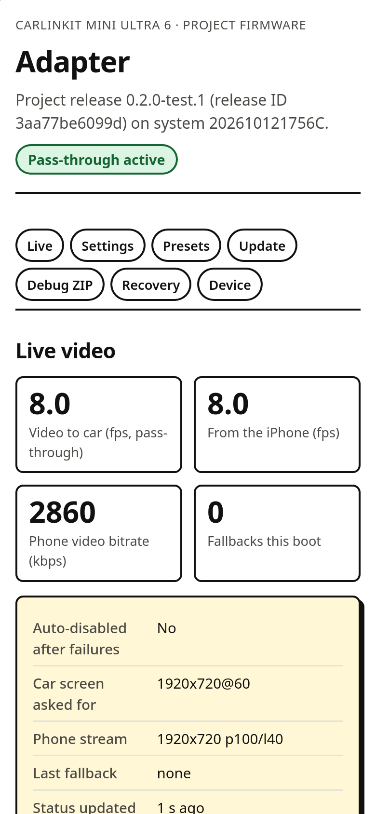
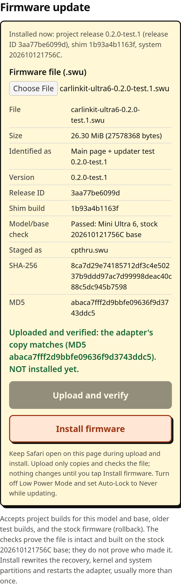

# Carlinkit Mini Ultra 6 firmware research

An experimental CarPlay pass-through modification for the Allwinner v553
Mini Ultra 6, developed through firmware analysis, AI-assisted engineering,
independent code review, and physical-device testing.

The aim is to forward the iPhone's compressed video to the car while keeping
the stock transcoder available for AirPlay and fallback.

## Current result

As of November 3, 2026, a custom pass-through image is installed on one
adapter. Its status page reports active pass-through and no fallbacks. Live
input/output stay around 8 fps during movement, so the performance goal is
**not yet achieved**. This is an investigation, not a stable release or a
demonstrated 60 fps upgrade.

## Latest test release: 0.2.0-test.1

A usability release. Video forwarding is unchanged.

- **One main page** at `http://192.168.50.100`: live input/output frame
  rates, bitrate, mode and fallbacks; every supported setting; presets with
  export/import; firmware update; debug ZIP; recovery; device info.
- **Built-in updater**: choose an SWU in Files, the phone validates and
  identifies it, upload with progress, the adapter verifies it, then a
  separate **Install firmware** button. Future project releases install from
  the page with no new bookmark.
- **Recovery**: stock video processing, reset project settings, stock
  factory reset, and stock rollback through the same updater (rollback not
  yet tested on an adapter).




Screenshots come from the test mock with sample data, not a live adapter.

### Install

See the [phone steps](phone-upload-v2/README.md). Short version:

- **Adapter already on 0.2+**: download the `.swu`, open
  `http://192.168.50.100`, Firmware update, choose it, Upload and verify,
  Install firmware.
- **First install** (stock, original pass-through or diagnostics.1): Safari
  needs the release's `bookmarklet.txt` saved as a bookmark once (one manual
  URL edit). Run it on the adapter page and use the same Upload / Install
  steps.

### Settings on the page

Each control writes exactly the property the stock CGI writes, with the stock
values (checked against the extracted stock `setprop.cgi`, `audioselect.cgi`
and page scripts):

| Setting | Property | Values | Takes effect |
|---|---|---|---|
| CarPlay video | `persist.cpthru.off` | pass-through / stock processing | next CarPlay connection |
| Audio delay | `persist.suding.wl.audio.latency` | phone decides, 300-1000 ms | next CarPlay connection |
| Audio stream mode | `persist.sys.carplay.audio.media.samplerate` | 44.1 / 48 kHz | after restart |
| Hotspot channel | `persist.sys.wifi.channel` | 36-48, 149-161 | after restart |
| Startup delay | `persist.sys.boot.delay` | 0-60 s | next power-on |
| Car GPS to iPhone | `persist.sys.headunit.gps.disable` | on / off | next CarPlay connection |
| Force display | `persist.suding.wireless.carplay.force.display` | off / on | next CarPlay connection |

"Takes effect" for the stock settings is expected behavior, not yet
confirmed on the adapter. There are no frame-rate, resolution or bitrate
controls: nothing in this firmware makes them work, and a 60 fps setting
would not prove 60 fps output.

### Known limits

- Still about 8 fps in the owner's car; cause unresolved. Use **Debug ZIP**.
- The checks prove a file is intact and built on the stock base, not who made
  it. There is no signature.
- Installing rewrites recovery, kernel and system. No recovery mode is known
  if that fails. Stock rollback is untested on a real adapter.
- The stock language menu, vendor online update, vendor feedback form and
  activation screen are not on the new page; rollback restores them.

## Diagnostic test build (0.1.0-diagnostics.1)

The previous release added frame-hook timing and the debug ZIP; both are part
of 0.2. Its phone steps are in [phone-upload-diag](phone-upload-diag/README.md).

## Source map

- `shim/`: ARM interposition shim, host tests, ABI checks and QEMU checks.
- `web/`: adapter settings/status interface and allowlisted local CGIs.
- `build_fw.py`: rebuilds and verifies a firmware derived from the exact stock
  image, preserving kernel/recovery payload bytes.
- `web/index.html`, `cpthru_main.js`, `cpthru_fw.js`: 0.2 main page and the
  firmware updater (shared with the first-install bookmark);
  `web/cgi-bin/cpthru_update.cgi` and the `downfile`/`submition`/
  `factoryreset` gateways lock staging and start the stock installer once.
- `phone-upload-v2/`: generic first-install bookmark (`build-v2.mjs`) and a
  compact exact-image fallback (`spec-v020.json`).
- `phone-upload/`: original reviewed upload-only Safari bookmarklet;
  `build.mjs --spec spec-diag.json` generates the diagnostic-image helper in
  `phone-upload-diag/` without touching the original files.
- `tests/`: namespace-isolated QEMU tests on the device busybox (stock log
  exporter, diagnostics CGIs, 0.2 update/settings CGIs and gateways), the
  firmware-check unit tests, a stateful mock adapter, and WebKit/Chromium
  tests of the main page, updater and bookmark.
- `phone-debug/`: temporary download-only log bookmarklet.
- Development notes will document verified behavior and remaining questions.

Vendor firmware, private log bundles, live screenshots and analysis databases
are kept out of Git source history. See [Releases](https://github.com/RexMan04/carlinkit-ultra6-firmware/releases)
for test images, the phone helper and exact hashes. Compatibility is limited
to the model and base firmware listed above.

## Development checks

The current workstation uses the paths configured in the Makefile and scripts.
Firmware input lives outside the repository under `~/models/staging/`.

```sh
make -C shim test
make -C shim arm
make -C shim qemu-test
python3 -I tests/ns_test.py
bun tests/status_poll.mjs
bun tests/diag_browser.mjs --fixture ~/models/staging/carlinkit-ultra6-fw/review/diag-tests/stock-logs-fixture.zip
python3 build_fw.py passthru_diag
bun phone-upload/build.mjs --spec phone-upload/spec-diag.json
bun phone-upload/test.mjs --dir phone-upload-diag
# 0.2
python3 build_fw.py release
bun tests/fw_unit.mjs
python3 -I tests/ns_v2_test.py
bun phone-upload/build-v2.mjs
bun phone-upload/build.mjs --spec phone-upload/spec-v020.json
bun tests/main_browser.mjs
bun phone-upload/test.mjs --dir phone-upload-v020-compact
bun tests/preview_server.mjs     # local preview with a simulated adapter
```

Run `make -C shim qemu-test` separately from `tests/ns_test.py`: it touches
host `/tmp/cpthru.build`, which trips that test's host-change check.

QEMU proves loading and hook binding, not real-time performance on the adapter.
`build_fw.py passthru` is retired so it can never overwrite the delivered
pass-through image.
Browser tests use loopback-only receivers and never flash a device.

## Research process

Kaden owns the hardware, set the objectives, chose the implementation path,
and performs physical-device tests. AI tools assist with decompilation,
source development and review. Findings distinguish static evidence, local
tests, and observations on the real device. Commit history records completed
work at its actual completion time.
