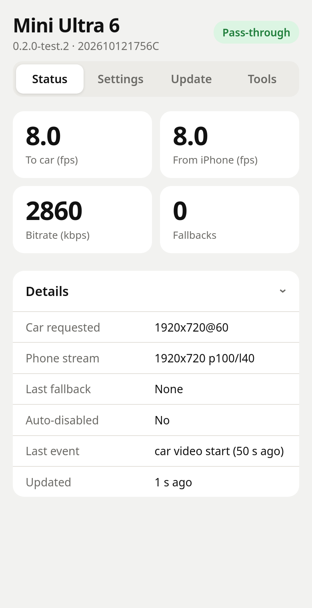
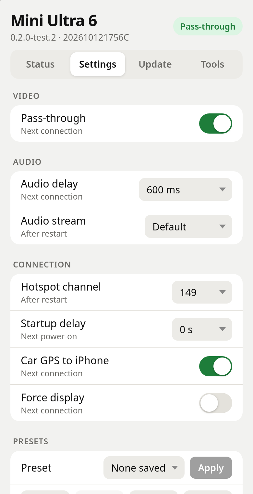
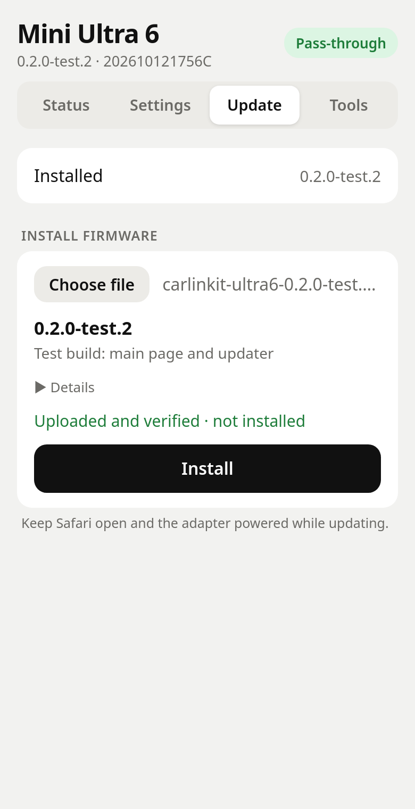

# Carlinkit Mini Ultra 6 firmware

Experimental CarPlay pass-through firmware for the Carlinkit Mini Ultra 6
(Allwinner v553, stock base 202610121756C). It forwards the iPhone's video to
the car instead of re-encoding it; AirPlay and fallback keep the stock path.

**Status:** test builds only. Measured ~8 fps in the owner's car; the cause is
still under investigation.

  

## Install

Download the latest `.swu` from [Releases](https://github.com/RexMan04/carlinkit-ultra6-firmware/releases),
then follow the [phone steps](phone-upload-v2/README.md).

## Features

- Adapter page with Status, Settings, Update and Tools tabs
- Live frame rate and bitrate
- Supported adapter settings, presets, export/import
- Built-in firmware updater
- Debug ZIP, stock video mode, factory reset, stock rollback

## Limits

- No signature: checks confirm the file is intact and built on the right base.
- No known recovery mode if an install fails. Stock rollback is untested.
- Only this model and base firmware.

## Source map

- `shim/`: ARM interposition shim, host tests, ABI checks and QEMU checks.
- `web/`: adapter settings/status interface and allowlisted local CGIs.
- `build_fw.py`: rebuilds and verifies a firmware derived from the exact stock
  image, preserving kernel/recovery payload bytes.
- `web/index.html`, `cpthru_main.js`, `cpthru_fw.js`: 0.2 main page and the
  firmware updater (shared with the first-install bookmark);
  `web/cgi-bin/cpthru_update.cgi` and the `downfile`/`submition`/
  `factoryreset` gateways lock staging and start the stock installer once.
- `phone-upload-v2/`: generic first-install bookmark (`build-v2.mjs`) and a
  compact exact-image fallback (`spec-v020.json`).
- `phone-upload/`: original reviewed upload-only Safari bookmarklet;
  `build.mjs --spec spec-diag.json` generates the diagnostic-image helper in
  `phone-upload-diag/` without touching the original files.
- `tests/`: namespace-isolated QEMU tests on the device busybox (stock log
  exporter, diagnostics CGIs, 0.2 update/settings CGIs and gateways), the
  firmware-check unit tests, a stateful mock adapter, and WebKit/Chromium
  tests of the main page, updater and bookmark.
- `phone-debug/`: temporary download-only log bookmarklet.
- Development notes will document verified behavior and remaining questions.

Vendor firmware, private log bundles, live screenshots and analysis databases
are kept out of Git source history. See [Releases](https://github.com/RexMan04/carlinkit-ultra6-firmware/releases)
for test images, the phone helper and exact hashes. Compatibility is limited
to the model and base firmware listed above.

## Development checks

The current workstation uses the paths configured in the Makefile and scripts.
Firmware input lives outside the repository under `~/models/staging/`.

```sh
make -C shim test
make -C shim arm
make -C shim qemu-test
python3 -I tests/ns_test.py
bun tests/status_poll.mjs
bun tests/diag_browser.mjs --fixture ~/models/staging/carlinkit-ultra6-fw/review/diag-tests/stock-logs-fixture.zip
python3 build_fw.py passthru_diag
bun phone-upload/build.mjs --spec phone-upload/spec-diag.json
bun phone-upload/test.mjs --dir phone-upload-diag
# 0.2
python3 build_fw.py release
bun tests/fw_unit.mjs
python3 -I tests/ns_v2_test.py
bun phone-upload/build-v2.mjs
bun phone-upload/build.mjs --spec phone-upload/spec-v020.json
bun tests/main_browser.mjs
bun phone-upload/test.mjs --dir phone-upload-v020-compact
bun tests/preview_server.mjs     # local preview with a simulated adapter
```

Run `make -C shim qemu-test` separately from `tests/ns_test.py`: it touches
host `/tmp/cpthru.build`, which trips that test's host-change check.

QEMU proves loading and hook binding, not real-time performance on the adapter.
`build_fw.py passthru` is retired so it can never overwrite the delivered
pass-through image.
Browser tests use loopback-only receivers and never flash a device.

## Research process

Kaden owns the hardware, set the objectives, chose the implementation path,
and performs physical-device tests. AI tools assist with decompilation,
source development and review. Findings distinguish static evidence, local
tests, and observations on the real device. Commit history records completed
work at its actual completion time.
